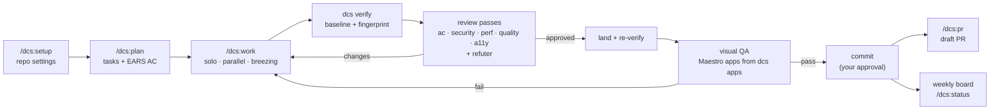
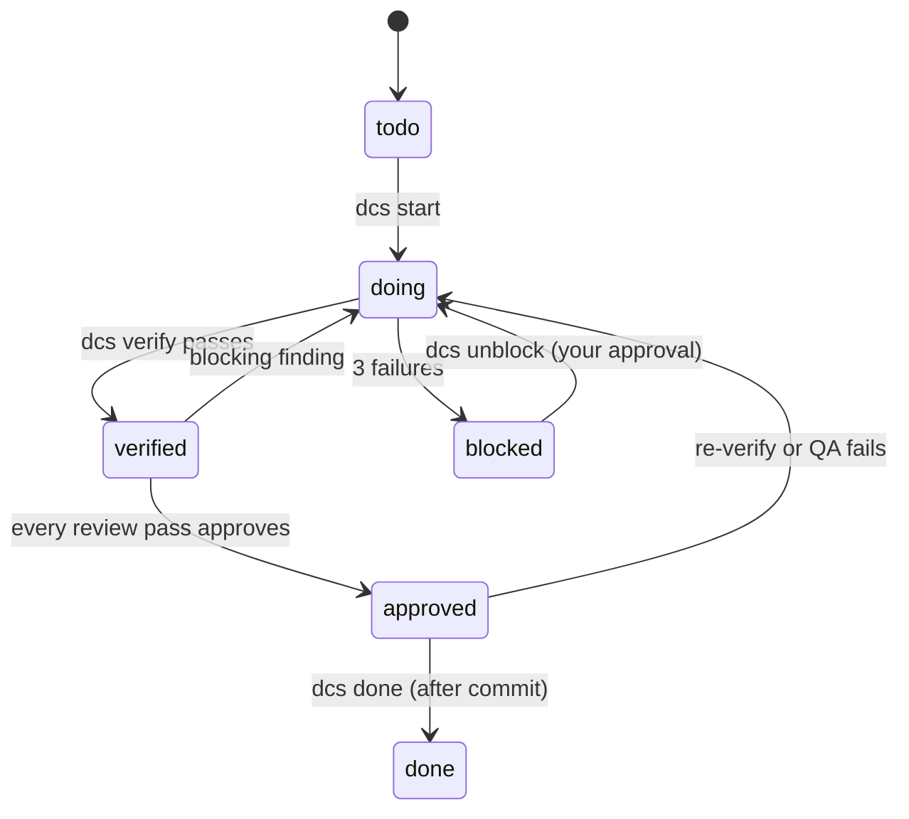

# dcs — Digital Creative Studio harness

A thin Claude Code plugin that runs one loop in every repo: plan → work → review → QA → commit → PR. The main session is the **Captain**. It talks to you, dispatches `dcs:worker` and `dcs:reviewer` subagents, and funnels every question back to you. A zero-dependency Node CLI (`dcs`) owns all state, and a guard hook enforces the rules.

**Local only.** No remote, never pushed.

## Install

```bash
claude plugin marketplace add ~/Developer/bin/dcs-harness
claude plugin install dcs@dcs-local
```

For `dcs` in your own terminal, link the CLI into a folder on your PATH (here `~/Developer/bin`):

```bash
ln -s ~/Developer/bin/dcs-harness/dcs/bin/dcs ~/Developer/bin/dcs
```

Then run `/dcs:setup` in each repo. The `dcs` on your PATH runs straight from this folder, but Claude Code loads the plugin from an installed copy under `~/.claude/plugins/cache/dcs-local/`. After changing anything in `dcs/`, bump `version` in `dcs/.claude-plugin/plugin.json` (update skips an unchanged version), commit, refresh the copy, and start a new session:

```bash
claude plugin update dcs@dcs-local
```

## The loop



Repo spec files (`*.spec.md`) get a `spec` task first and a `spec-sync` task last. `/dcs:review --diff` reviews any branch as a report only, and records nothing.

## Task states



- Three failed verifies in a row count as one failure.
- A review's verdict comes from its findings. Only unrefuted critical or major findings with an exact quote block, as does any unmet AC.
- A review is only recorded against a fresh verify fingerprint.

## Commands

| Skill | What it does |
|---|---|
| `/dcs:setup` | Detects the repo's settings and confirms each one with you. Writes them to `.claude/dcs/settings.json`. |
| `/dcs:plan` | Turns a request (optional Jira key, Figma URLs) into approved tasks and board rows. |
| `/dcs:work` | Runs approved tasks through worker → verify → review → land → QA → commit. |
| `/dcs:review` | Reviews one task (recorded), or the branch diff with `--diff` (report only). |
| `/dcs:pr` | Drafts the PR in house format from finished tasks and evidence, then opens it as a draft. |
| `/dcs:pr-review` | Reviews any PR by number or URL with the review passes and the refuter, then posts approved inline comments as one review. |
| `/dcs:pr-fix` | Handles review comments on your PR: verifies each against the code, fixes accepted ones as dcs tasks, posts approved replies with commit links, and resolves the threads. |
| `/dcs:visual-qa` | Runs the reference-diff visual QA protocol on the iOS simulator and Android emulator. |
| `/dcs:status` | Writes the weekly status report from the board. |

CLI: `dcs init check add list show next run start note verify diff apps review land qa prcheck purge approve-spec done unblock board decide decisions stats brief guard`. The skills call these for you. Plain `dcs` lists them.

## Guardrails (PreToolUse hook: `dcs guard`)

| Rules | What they cover | Decision |
|---|---|---|
| G1 · G4 · G5 · G6 · G7 · G8 | commit, push, `dcs unblock`, `dcs approve-spec`, gh writes, `dcs start --branch-ok` (a Jira task off its ticket's branch). GraphQL reads, review-comment replies and `resolveReviewThread` are not asked | ask |
| G2 · G3 | Co-Authored-By lines; missing `Fixes:` trailer; unreadable dcs files | deny |
| B1 | Bypass mode: every approval above is denied. Auto mode: denied unless a `Bash(<prefix> *)` rule in the `permissions.ask` of your user settings covers the command | deny |
| R1 · R2 | workers: no commit, push or state changes; reviewers: read-only | deny |
| D1–D6 | sudo, force push, `--no-verify`, pushing main or all branches; hard reset, `rm -r` and dynamic command words ask | deny / ask |
| S1–S4 | protected files (`.env`, keys, `~/.ssh`, `~/.aws`, gh config…), secrets in commands or content, credential reads, Maestro cloud, analytics and AI | deny |
| G10 | `dcs purge --yes` | ask |
| G9 | `gh pr create` in a repo with `prChecks`, until `dcs prcheck` passed on the current HEAD with a clean tree | deny |
| C1 | writes outside the repo, its worktrees, the temp dir and Claude memory | ask |

Every decision is logged to `~/.dcs/guard/<YYYY-MM>.jsonl`. If the guard itself errors, the tool call is blocked; disable the plugin to get past it. A guard timeout (10 s) lets the call through.

## Where state lives

| Path | What | Committed |
|---|---|---|
| `<repo>/.claude/dcs/` | `settings.json`, `tasks.json`, and `evidence/<id>/` (verify logs, reviews, QA, Maestro captures) | never (`.git/info/exclude`) |
| `<repo>.dcs-worktrees/<id>/` | worktrees for parallel and breezing tasks | never |
| `~/.dcs/board/` | the weekly cross-project board (JSON + `.md`) that feeds `/dcs:status` | — |
| `~/.dcs/guard/` | guard audit log | — |
| `~/.dcs/repos.json` | every repo dcs has run in, used by `dcs purge` | — |

`dcs purge` lists every registered repo's `evidence/` (screenshots, recordings, logs, notes, flows) and the guard logs. `dcs purge --yes` moves them to `~/.Trash/dcs-purge-<time>/`. Tasks, settings, the prcheck status and the weekly board stay.

## Settings

`/dcs:setup` writes these. The full shape and rules are in [`dcs/skills/setup/SKILL.md`](dcs/skills/setup/SKILL.md).

- `maestro` is `false`, or a list of example apps, each with the `paths` it covers, an optional `brandSwitcher`, and per-platform `knownIssues` (`openLink-noop`, `back-noop`, `metro-banner`). `dcs apps <id>` picks the apps a task's diff touches.
- Maestro always runs locally, with `MAESTRO_CLI_NO_ANALYTICS=true`.

## Agent Tree

A live view of a run: the Captain, each worker and reviewer, with status, cost and time. It lives in [`agent-tree/`](agent-tree/) and does not change the run.

```bash
node agent-tree/server.mjs <repo>   # then open http://127.0.0.1:4173/
```

- The Captain labels every dispatch with its task: the Agent tool `description` starts with the task id, as in `t2 Build the plan cards`. This is rule 16 in `captain.md`. Without it, an agent has no column in the tree.
- After a change to `captain.md`, run `claude plugin update dcs@dcs-local`.
- The server reads the Claude Code transcripts and `.claude/dcs/tasks.json`. It listens on `127.0.0.1` only.
- Recorded runs go to `agent-tree/runs/`. They hold real task names and costs. Keep the folder out of any shared or synced location.
- More: [`agent-tree/README.md`](agent-tree/README.md).

## Where the details are

- [`dcs/references/captain.md`](dcs/references/captain.md): Captain rules (16) and the dispatch templates.
- `dcs/skills/*/SKILL.md`: step-by-step for each command.
- `dcs/agents/`: the worker and reviewer.

## Development

Node ≥ 22, standard library only, CommonJS.

```bash
node --test test/*.test.js
```
